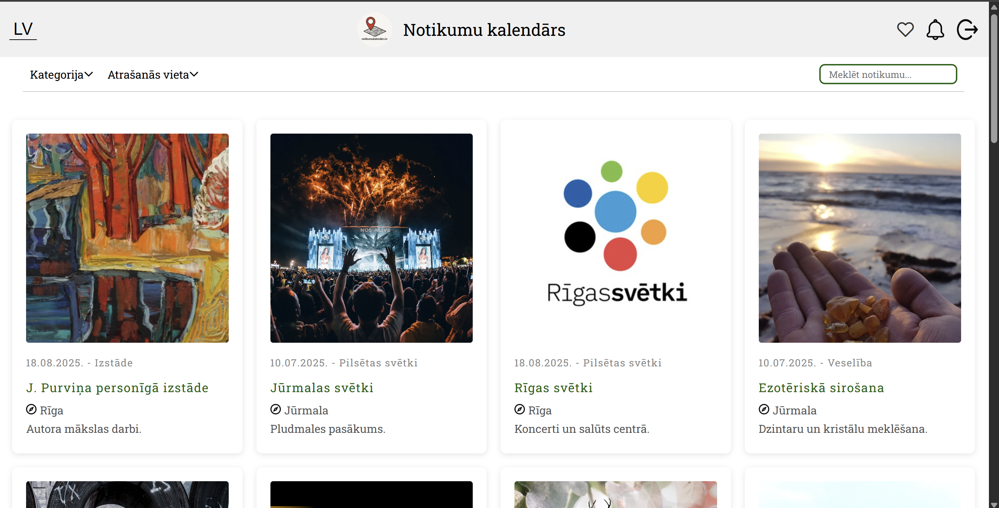

# Notikumu kalendārs

Notikumu kalendārs is a university **group study project**: a web application for browsing cultural and public events in Latvia (concerts, festivals, city celebrations, and similar).

The system was built as coursework to practice full-stack development: a Vue 3 single-page app talking to a Node.js (Express) API backed by MongoDB.



## Features

- Event discovery - scrollable list of events with search, category, and location filters; each item links to a detail page with description and an embedded map.
- User accounts - registration and login; passwords are hashed on the server (bcrypt); sessions use JWT stored in `localStorage`.
- Favorites - logged-in users can save events and open a dedicated favorites view (API-backed).

The backend also exposes listing and favorite endpoints intended to drive the main catalog from the database; the current frontend ships a large in-app demo dataset for the home list (the API hook is present but commented out in `EventListView.vue`), while login, registration, and favorites use `http://localhost:5000`.

## Tech stack


| Layer    | Technologies                                |
| -------- | ------------------------------------------- |
| Frontend | Vue 3, Vue Router, PrimeVue, Axios, Vue CLI |
| Backend  | Express, Mongoose, JWT, bcrypt, CORS        |
| Database | MongoDB                                     |


## Prerequisites

- [Node.js](https://nodejs.org/) (LTS recommended)
- A running [MongoDB](https://www.mongodb.com/) instance (local or remote)

## Configuration

Create `backend/.env` (not committed to git) with at least:

```env
MONGO_URI=mongodb://localhost:27017/notikumukalendars
JWT_SECRET=your-secret-key
PORT=5000
```

Adjust `MONGO_URI` if your database name or host differs.

## Setup and run

1. Install dependencies (repository root, backend, and frontend each have their own `package.json`):
  ```bash
   npm install
   cd backend && npm install
   cd ../frontend && npm install
  ```
2. Start MongoDB and ensure it matches `MONGO_URI`.
3. Optional -seed demo data (users, events, favorites, reminders):
  ```bash
   cd backend
   npm run seed
  ```
   The seed script targets `mongodb://localhost:27017/notikumukalendars` by default (see `backend/seeds/seedData.js`).
4. Run the app
  From the repository root:
   This starts the API (default port 5000) and the Vue dev server (typically 8080) via `concurrently`.
   Alternatively, in two terminals:
5. Open the URL printed by the Vue CLI (e.g. `http://localhost:8080`).

## Production build (frontend)

```bash
cd frontend
npm run build
```

Static output is written to `frontend/dist/`.

## Project structure (overview)

- `frontend/` - Vue application (`src/views`, `src/components`, `src/router`)
- `backend/` - Express API (`server.js`, `routes/`, `models/`, `seeds/`)

